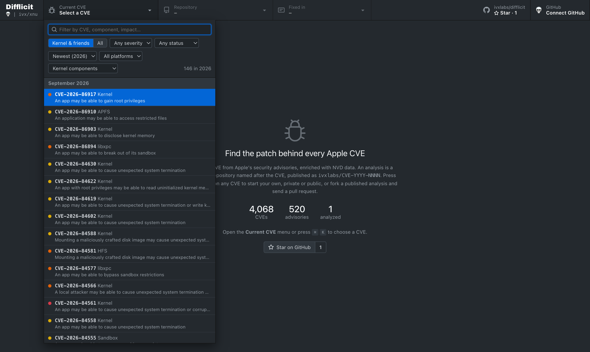
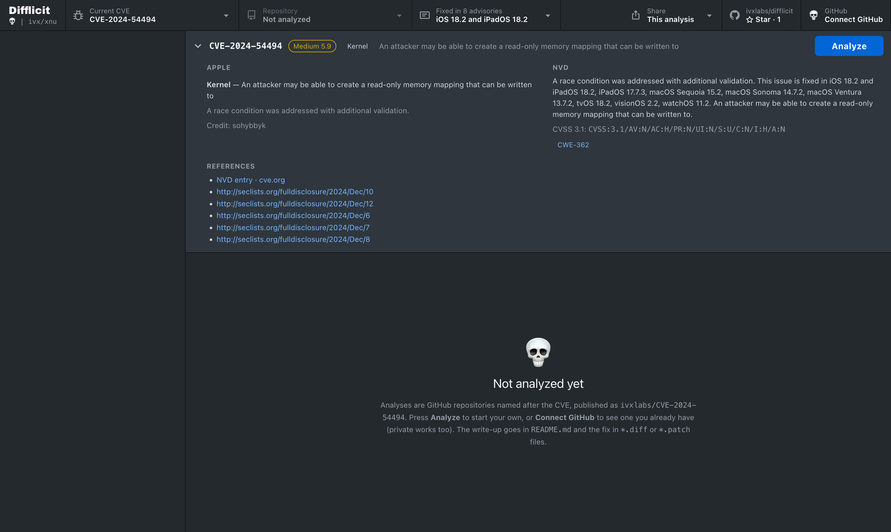

<div align="center">

# 💀 Difflicit

**Patch diffing and analysis, for CVEs or anything else with a patch behind it.**

Pick a CVE, read what the vendor and NVD say about it, and open the patch that fixed it<br>
in a diff viewer that feels like GitHub Desktop. Bring your own analyses, private ones included.

[](https://xnu.ivx.run)
[](LICENSE)
[](#-run-your-own-instance)
[](https://vite.dev)

[**Open ivx/xnu →**](https://xnu.ivx.run) · [Documentation](https://ivx.run/docs/difflicit/) · [How it works](#-how-it-works) · [Write an analysis](#-write-an-analysis) · [Run your own](#-run-your-own-instance)

<br>


<sub>The diff viewer, showing XNU's <code>osfmk/vm</code> changes between <code>xnu-11215.41.3</code> and <code>xnu-11215.61.5</code> as sample data.</sub>

</div>

---

Difflicit works on **projects**: whatever an instance analyzes. **ivx/xnu**, the instance this repository runs at
[xnu.ivx.run](https://xnu.ivx.run), maps CVEs to projects: every CVE from Apple's security advisories since 2020,
enriched with NVD data, with a focus on XNU and its neighbours. Another instance could track bug reports,
releases or anything else, with its own catalog and naming convention.

## ✨ What you get

- 🔎 **Every CVE at your fingertips.** Search by id, component or impact; filter by severity, platform, year and
  whether anyone has analyzed it yet. Press <kbd>⌘</kbd> <kbd>O</kbd> anywhere.
- ⌨️ **Keyboard first.** <kbd>⌘</kbd> <kbd>K</kbd> searches the open analysis, write-up and patches, and jumps to
  the line; <kbd>⌘</kbd> <kbd>P</kbd> runs any command. (<kbd>Ctrl</kbd> on Windows and Linux.)
- 🧾 **Vendor and NVD side by side.** Apple's component, impact and credit next to the CVSS vector, CWE and
  references, and every advisory the fix shipped in.
- 🪓 **A real diff viewer.** Unified or split, line numbers, hunks, and files with tens of thousands of lines that
  scroll as smoothly as small ones: only the rows on screen are rendered.
- 🧪 **Analyses live in Git.** An analysis is just a GitHub repository with an `analysis.json` naming the project,
  a write-up in `README.md` and the fix in `*.diff` / `*.patch` files. Fork it, improve it, send a pull request.
- 🔬 **Diff two versions.** In the desktop app an analysis can instead be generated: the diff between two git refs
  (tags, branches, commits) of any repository, or two binary versions, matched function by function with radare2.
- 🚀 **One button to start.** **Analyze** opens your repository for the CVE, or creates or forks one for you.
- 🔗 **Shareable to the line.** The URL always describes what's on screen: CVE, repository and file. Copy it,
  post it to X or LinkedIn, or **copy an embed code** to put the analysis right inside an article or blog post.
- 🪶 **Featherweight.** A static site with no server or database. The catalog is sharded so the browser only
  downloads the slice you're looking at.
- 🖥 **Also a desktop app** for macOS, Windows and Linux: the same Difflicit in a native window (about 8 MB),
  the groundwork for working with local files and analysis tools.

<table>
  <tr>
    <td width="50%"></td>
    <td width="50%"></td>
  </tr>
  <tr>
    <td align="center"><sub>Find a CVE: filters, scopes, and a year or component per download.</sub></td>
    <td align="center"><sub>What Apple and NVD say, every advisory it shipped in, and <b>Analyze</b>.</sub></td>
  </tr>
</table>

## 🧭 How it works

```
 GitHub Actions (weekly)                              Your browser (Difflicit, on GitHub Pages)
 ───────────────────────                              ─────────────────────────────────────────
 scripts/main.py
   Apple advisories ─┐
   NVD feeds ────────┼─► static JSON ─► CDN (R2) ───► CVE list and details
   GitHub repo list ─┘                                 cdn.ivx.run/applesec/api

 GitHub repositories with an analysis.json ──────────► write-ups and diffs
                                                        straight from GitHub
```

**The catalog.** The projects come from a catalog. With none configured, as in the desktop app, it's your own
projects: every folder in `~/Difflicit` with an `analysis.json`. A site can point at a remote one instead, a static
JSON API, as xnu.ivx.run does. On ivx/xnu, the `scrape` workflow fetches Apple's
advisories and the NVD feeds once a week, writes the API, and syncs it to an S3-compatible bucket; only files whose
content changed are uploaded. The format is generic (its types are in `src/types.ts`), so any script can write one:

| File | Contents |
| --- | --- |
| `index.json` | Headline stats, the facets to filter by (with their shards), and quick scopes. A few KB, always revalidated |
| `years/2026.json` | Summaries of the projects in one shard: id, summary, date, badge, tags and facet values |
| `components/kernel.json` | Another facet's shard. The browser loads the narrowest one chosen |
| `projects/CVE-2026-12345.json` | One project's details as display sections, plus an optional toolbar menu |

**Analyses.** A repository (or, in the desktop app, a folder) is an analysis when its root has an `analysis.json`
naming the project ([schema](analysis.schema.json)):

```json
{ "$schema": "https://raw.githubusercontent.com/ivxlabs/difflicit/main/analysis.schema.json", "project": "CVE-2024-54494" }
```

The instance's naming convention says where to look. For each project, Difflicit checks on GitHub:

- `<owner>/<name>`, the published analysis (e.g. `ivxlabs/CVE-2024-54494` on ivx/xnu);
- that repository's forks;
- once you're connected, every repository you can see whose name follows the convention, private ones included.

Only repositories whose `analysis.json` names the project count.

## 🔬 Write an analysis

1. Open a project (on ivx/xnu, a CVE) and press **Analyze**. Difflicit signs you in if needed, then opens your
   repository for it, or offers to **fork** the published analysis or **create** one for you (private or public),
   named by the convention and with its `analysis.json`.
2. Write up the root cause in `README.md`, and add the fix as one or more `*.diff` / `*.patch` files: `git diff`,
   `git format-patch` and `diff -u` output all work.
3. Push. Your analysis shows up in Difflicit straight away, under **Repository**.
4. Working from a fork? **Create pull request** sends it back. Once merged, everyone sees it.

## 🔐 GitHub access and privacy

How Difflicit reaches GitHub on your behalf is chosen when the site is built:

| | Bring your own token (default) | Sign In (e.g. xnu.ivx.run) |
| --- | --- | --- |
| How | Paste a GitHub personal access token | Sign in with an [ivx account](https://iam.ivx.run) (OAuth 2.1 + PKCE) |
| Where the GitHub token lives | Your browser's local storage, sent only to `api.github.com` | Encrypted at iam.ivx.run, which calls GitHub for you; the browser never sees it |
| Enabled by | Nothing, it's always there | The `SUPABASE_URL`, `SUPABASE_CLIENT_ID` and `IAM_URL` variables. Without them none of this code is built |

Anonymous visitors can read every public analysis; GitHub limits them to 60 API requests an hour.

README HTML from analysis repositories is sanitized before it is shown, and a Content Security Policy restricts
where the page can load scripts from and send data to.

## 🖥 Desktop app

Difflicit is also a [Tauri](https://tauri.app) app: the same interface in a native window, built for macOS
(Apple Silicon and Intel), Windows and Linux. Download it from the
[Releases](https://github.com/ivxlabs/difflicit/releases) page.

Analyses run locally in the desktop app. **Analyze** on the website signs you in, creates or forks your
repository, then opens it in the app with a `difflicit://` link (and offers the download if the app doesn't
open). The app clones it to `~/Difflicit/<owner>/<repo>` with your system `git` and opens the folder; private
repositories use the GitHub credentials git already has.

The builds aren't code-signed yet, so the first launch needs one extra step: on **macOS**, right-click the app and
choose *Open*; on **Windows**, choose *More info → Run anyway* in the SmartScreen prompt.

To build it yourself you need [Rust](https://rustup.rs) and
[Tauri's system dependencies](https://tauri.app/start/prerequisites/):

```sh
npm install
npm run tauri dev      # the app, live-reloading
npm run tauri build    # installers in src-tauri/target/release/bundle
```

### Releasing

Versions follow [semantic versioning](https://semver.org) and live in `package.json`; the app reads its version
from there.

```sh
npm run bump -- patch            # or minor, major, 1.4.0, 2.0.0-beta.1, prerelease --preid beta
npm run tauri build              # build that version locally, if you like
npm run release                  # commit the version, tag v1.4.0 and push both
npm run release -- minor         # or bump and release in one go
```

`npm run release` refuses to run with uncommitted changes (other than the version), behind `origin`, or when
the tag exists, and asks before pushing. The pushed tag runs `.github/workflows/desktop.yml`, which drafts a
GitHub Release with notes from the commits since the previous version, builds macOS (universal), Windows and
Linux, and attaches the installers. Review the draft and publish it; versions with a suffix (`-beta.1`) are
marked as pre-releases. To rebuild a tag, run the workflow by hand with that tag.

## 🛠 Run your own instance

Difflicit is generic: point it at your own data and repositories and it becomes your instance.

### Configure it

`difflicit.config.json` holds everything specific to an instance:

| Key | What |
| --- | --- |
| `name` | Shown under the Difflicit logo, in page titles and in shared posts, e.g. `ivx/xnu` |
| `icon` | Shown next to the name, e.g. `💀` |
| `catalog` | Optional URL of a project catalog (or the `CATALOG` variable). Without one, the desktop app lists your own projects: the folders in `~/Difflicit` with an `analysis.json`. xnu.ivx.run's is set in `pages.yml` |
| `projectRepo` | The repository the Star button points at (CI uses the repository being built) |
| `projects.tagline`, `projects.about` | The welcome page's title and first sentence |
| `projects.owner` | The GitHub account whose repositories are the published analyses, e.g. `ivxlabs` |
| `projects.id` | The pattern project ids follow (a regular expression), e.g. `CVE-\\d{4}-\\d{4,}` |
| `projects.repo` | How analysis repositories are named, e.g. `{id}` or `analysis-{id}` |

### Develop locally

```sh
npm install
(cd scripts && uv run main.py --out ../public/api)   # add --limit 20 for a quick sample
VITE_CATALOG=/api npm run dev
```

- To try Sign In locally, set `VITE_SUPABASE_URL`, `VITE_SUPABASE_CLIENT_ID` and `VITE_IAM_URL` (e.g. in
  `.env.local`) and add `http://localhost:5173` to iam's `GITHUB_ORIGINS`. The build prints whether Sign In is on.

### Deploy it

**1. The site, on GitHub Pages.** *Settings → Pages → Source: GitHub Actions*, plus a custom domain if you like.
`.github/workflows/pages.yml` builds and deploys on every push to `main`.

**2. The data, on Cloudflare R2** (any S3-compatible storage works):

1. Create a bucket, connect a custom domain (e.g. `cdn.ivx.run`), and add a CORS rule allowing `GET` from any origin
   (`"AllowedOrigins": ["*"]`). The data is public, and the desktop app's pages don't come from a website.
2. Create an R2 API token with *Object Read & Write* on the bucket.
3. Add these to the repository (*Settings → Secrets and variables → Actions*; either tab works):

   | Name | Value |
   | --- | --- |
   | `S3_ENDPOINT` | `https://<account-id>.r2.cloudflarestorage.com` |
   | `S3_BUCKET` | The bucket name |
   | `S3_ACCESS_KEY_ID`, `S3_SECRET_ACCESS_KEY` | From the R2 API token (as **secrets**) |
   | `S3_PREFIX` | Optional, defaults to `applesec/api` |
   | `CATALOG` | Optional, the catalog's URL for the site (`pages.yml` defaults to xnu.ivx.run's) |

4. Run the `scrape` workflow once by hand. After that it runs weekly; run it again after publishing a new analysis
   to refresh the "analyzed" flags (a CVE's own page always checks GitHub live).

**3. Sign In** (optional, needs an [iam.ivx.run](https://iam.ivx.run) deployment):

1. In Supabase, *Authentication → OAuth Server → Clients*: add a **public** client with redirect URI
   `https://<your site>/`.
2. In iam's `wrangler.jsonc`, add the client id to `GITHUB_CLIENTS` and your site to `GITHUB_ORIGINS`.
3. Set `SUPABASE_URL`, `SUPABASE_CLIENT_ID` and `IAM_URL` in this repository and rebuild.

Users then allow GitHub access once, from their ivx account page.

## 🤝 Contributing

Pull requests are welcome, including ones written by AI agents. Agents (and the people running them) should
read [AGENTS.md](AGENTS.md) first: how to build and check the project, and the disclosure every AI-written pull
request needs.

## 📄 License

Difflicit is licensed under the [GNU General Public License, version 3 only](LICENSE) (`GPL-3.0-only`).

```
Difflicit: patch diffing and analysis for CVEs
Copyright (C) 2026 ivx research (Vikrant Singh Chauhan)

This program is free software: you can redistribute it and/or modify it under the terms of the
GNU General Public License as published by the Free Software Foundation, version 3.

This program is distributed in the hope that it will be useful, but WITHOUT ANY WARRANTY; without
even the implied warranty of MERCHANTABILITY or FITNESS FOR A PARTICULAR PURPOSE. See the GNU
General Public License for more details.
```

<div align="center"><sub>Made with 💀 by <a href="https://github.com/ivxlabs">ivxlabs</a></sub></div>
