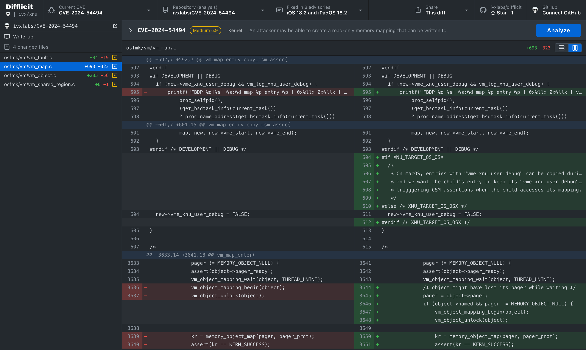

<div align="center">


# Difflicit

**An exploit development toolkit for reproducing ndays and finding 0days.**

Pick a project. Open the patch. Read the fix in a real diff viewer.<br>
Write up what you learned as an analysis that lives in Git — think Jupyter, but for exploit development.

[](https://xnu.ivx.run)
[](LICENSE)

[](https://github.com/ivxlabs/difflicit/actions/workflows/scrape.yml)
[](https://github.com/ivxlabs/difflicit/actions/workflows/desktop.yml)

[**Open ivx/xnu →**](https://xnu.ivx.run) · [Documentation](https://ivx.run/docs/difflicit/) · [Run your own](#-run-your-own-instance)

<br>

<table>
  <tr>
    <td></td>
  </tr>
  <tr>
    <td align="center"><sub>XNU's <code>osfmk/vm</code> changes between <code>xnu-11215.41.3</code> and <code>xnu-11215.61.5</code>, as sample data</sub></td>
  </tr>
</table>

</div>

---

Every exploit starts the same way: what actually changed? For an nday, the fix patch answers it; for a 0day,
diff two versions and look. Difflicit is that toolkit — diff it, write the root cause next to the fix, and
ship it all as an analysis that lives in Git. One repo per analysis: forkable, reproducible, plain text.

Difflicit works on **projects** — whatever an instance analyzes. **ivx/xnu** at [xnu.ivx.run](https://xnu.ivx.run)
tracks every Apple CVE since 2020, enriched with NVD data, focused on XNU. Other instances can track anything —
their own catalog, their own naming rules.

## 🖥 Desktop app

**Analyses run locally** in the [Tauri](https://tauri.app) app ([Releases](https://github.com/ivxlabs/difflicit/releases)
— macOS, Windows, Linux): a project folder holds **artifacts** (a git repo, or files you add), each with
versions to diff — `git diff` for refs, radare2's `radiff2` for binaries (function by function, with
per-function disassembly diffs), `git diff --no-index` for everything else. **Analyze** predicts what a change was
about from patterns in its diff (no AI) and writes it up as a diffmd note in the project, edited block by block. **Get a copy** on the website hands the repo over via a `difflicit://`
link; it clones to `~/Difflicit/<owner>/<repo>` with your system `git`.
Builds aren't code-signed: macOS right-click → *Open*, Windows *More info → Run anyway*.

Needs [Rust](https://rustup.rs) and [Tauri's system dependencies](https://tauri.app/start/prerequisites/):

```sh
npm install
npm run tauri dev      # the app, live-reloading
npm run tauri build    # installers in src-tauri/target/release/bundle
```

## 🛠 Run your own instance

Difflicit is generic — point it at your own data and it's your instance. Settings live in
`difflicit.config.json`: the catalog URL, the `projects.owner` whose repos hold the published analyses, the
project id pattern, the repo naming. Deploy runs on GitHub Pages (`pages` workflow); `scrape` writes the
catalog weekly to any S3-compatible bucket (`S3_ENDPOINT`, `S3_BUCKET`, `S3_ACCESS_KEY_ID`,
`S3_SECRET_ACCESS_KEY` as Actions secrets, optional `S3_PREFIX` and `CATALOG`).

```sh
npm install
(cd scripts && uv run main.py --out ../public/api)   # add --limit 20 for a quick sample
VITE_CATALOG=/api npm run dev
```

## 🤝 Contributing

PRs welcome — AI-agent-written ones included. Agents: read [AGENTS.md](AGENTS.md) first for the build/check
workflow and the required AI disclosure.

## 📄 License

Difflicit is licensed under the [GNU General Public License, version 3 only](LICENSE) (`GPL-3.0-only`).

```
Difflicit: an exploit development toolkit for reproducing ndays and finding 0days
Copyright (C) 2026 ivx research (Vikrant Singh Chauhan)

This program is free software: you can redistribute it and/or modify it under the terms of the
GNU General Public License as published by the Free Software Foundation, version 3.

This program is distributed in the hope that it will be useful, but WITHOUT ANY WARRANTY; without
even the implied warranty of MERCHANTABILITY or FITNESS FOR A PARTICULAR PURPOSE. See the GNU
General Public License for more details.
```
